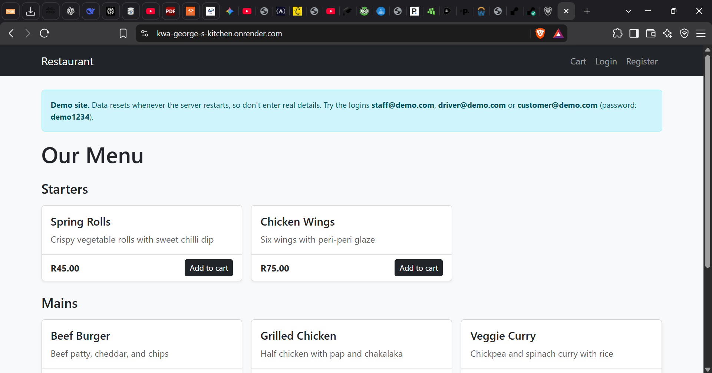
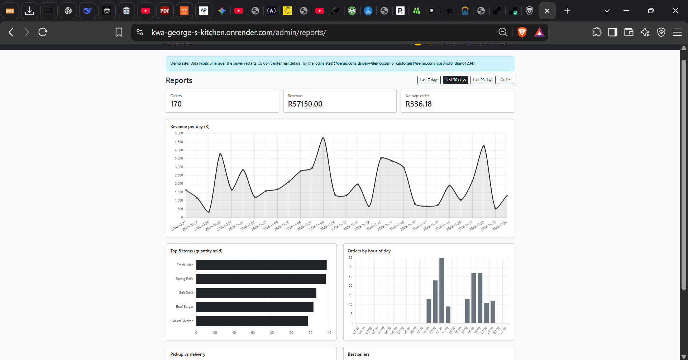

# Restaurant Ordering & Delivery App

A full-stack web app for a restaurant: customers browse the menu and order for pickup or delivery, staff run the kitchen and the menu, drivers handle deliveries, and a reports page turns the order data into sales insights.

**Live demo:** https://kwa-george-s-kitchen.onrender.com

> The demo runs on a free hosting plan. If it has been idle, the first load can take about a minute while the server wakes up. The data resets whenever the server restarts.

### Demo logins

| Role | Email | Password |
|---|---|---|
| Staff | `staff@demo.com` | `demo1234` |
| Driver | `driver@demo.com` | `demo1234` |
| Customer | `customer@demo.com` | `demo1234` |

You can also register your own customer account. Please don't enter real personal details on the demo.

## Screenshots

| Menu | Checkout |
|---|---|
|  |  |

| Staff orders | Reports |
|---|---|
|  |  |


## Features

**Customers**
- Browse the menu by category and add items to a cart
- Choose pickup (free) or delivery (flat fee) at checkout
- Order history and order status tracking, with the driver's name once assigned

**Staff**
- Order dashboard with filters by status
- Move orders through their lifecycle, or cancel them
- Assign drivers to delivery orders (an order can't go "Out for delivery" without one)
- Manage the menu: add, edit and re-price items, hide or show items, add categories

**Drivers**
- Personal delivery list with customer phone, address, items and amount to collect
- Mark orders as picked up and delivered (own deliveries only)

**Reports (staff)**
- Orders, revenue and average order value for the last 7, 30 or 90 days
- Revenue per day, top 5 items, orders by hour of day, pickup vs delivery split
- Built with plain SQL (joins, grouping and aggregates) and charted with Chart.js

### Order lifecycle

- **Pickup:** Placed → Confirmed → Preparing → Ready for pickup → Completed
- **Delivery:** Placed → Confirmed → Preparing → Out for delivery → Delivered
- Either type can be Cancelled until it is finished

## Tech stack

- **Backend:** Python, Flask, Flask-SQLAlchemy, Flask-Login, Flask-WTF (CSRF protection)
- **Database:** SQLite (SQLAlchemy models, easy to switch to PostgreSQL)
- **Frontend:** Jinja2 templates, Bootstrap 5, Chart.js
- **Testing:** pytest (28 tests)
- **Hosting:** gunicorn on Render

## Run it locally

```bash
git clone https://github.com/Hlamulani/kwa-george-s-kitchen.git
cd kwa-george-s-kitchen

python -m venv venv
venv\Scripts\activate          # macOS/Linux: source venv/bin/activate

pip install -r requirements.txt
python seed.py                 # creates the database with a sample menu
python run.py
```

Open http://127.0.0.1:5000.

Accounts you register are customers. To make a staff or driver account, register it first, then run:

```bash
python set_role.py you@example.com staff
python set_role.py driver@example.com driver
```

Optional: `python seed_orders.py` adds 60 days of fake orders so the reports page has data (`python seed_orders.py --clear` removes them).

To try the demo mode locally (sample menu, demo logins and demo orders on an empty database), set `DEMO_MODE=1` and `DATABASE_URL=sqlite:///demo.db` before running `python run.py`.

## Run the tests

```bash
python -m pytest -v
```

The tests use an in-memory database and cover order totals and delivery fees, price snapshots, the status flow, driver rules, registration and login, and role-based access.

## Project structure

```
app/
├── __init__.py        # app factory, extensions
├── models.py          # User, Category, MenuItem, Order, OrderItem, Delivery
├── demo.py            # demo data used when DEMO_MODE=1
├── routes/            # menu, auth, cart (orders), admin, driver, reports
└── templates/         # Jinja2 templates
tests/                 # pytest suite
config.py              # configuration (secret key, database, demo mode)
seed.py                # sample menu
seed_orders.py         # fake order history for reports
set_role.py            # promote a user to staff or driver
```

## Design notes

- Order items store the price at the time of purchase, so menu price changes never alter past orders.
- Passwords are hashed, every form uses a CSRF token, and each role can only open its own pages.
- Report timestamps are stored in UTC and shown in South African time (UTC+2).

## Known limitations and next steps

- Payment is cash on pickup or delivery; online payments are not implemented
- Flat delivery fee, no delivery zones or distance pricing
- The demo database resets on every restart (free hosting has no persistent storage)
- Ideas: email or SMS notifications, live order updates, PostgreSQL in production

## Author

Hlamulani Mbhiza(https://github.com/Hlamulani)